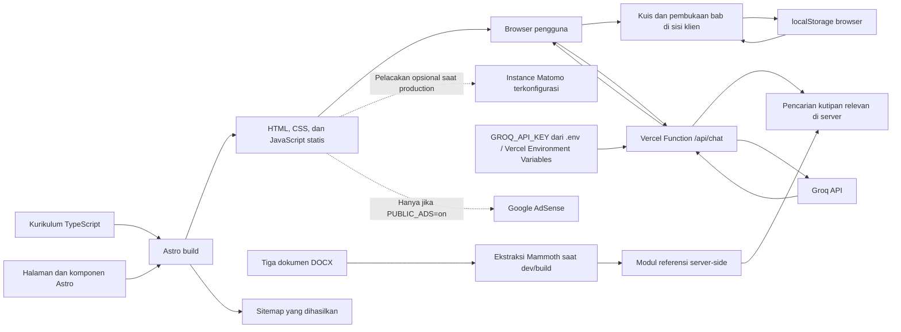

# Lingovela

## 1. Nama dan Gambaran Umum Proyek

**Lingovela** adalah situs untuk belajar bahasa Spanyol bagi penutur bahasa
Indonesia. Materi tingkat pemula disajikan dalam bahasa Indonesia dan disusun
menjadi pelajaran, kuis, serta jalur belajar dengan bab yang terbuka secara
bertahap.

Halaman pembelajaran dibuat sebagai situs statis dengan Astro. Kuis berjalan di
browser dan progres tersimpan di browser masing-masing pengguna. Chatbot
menggunakan Vercel Function terpisah agar API key Groq hanya berada di server.

## 2. Pernyataan Masalah

Pemula yang berbahasa Indonesia mungkin membutuhkan penjelasan, terjemahan, dan latihan bahasa Spanyol yang tersedia dalam satu alur, tanpa harus bergantung pada materi yang ditujukan bagi penutur bahasa lain. Kumpulan pelajaran saja juga dapat menyulitkan pengguna menentukan materi berikutnya atau mengukur
pemahaman mereka.

Lingovela dirancang untuk membantu mengatasi kebutuhan tersebut melalui penjelasan berbahasa Indonesia, contoh, kuis, dan urutan bab yang jelas.

## 3. Solusi dan Tujuan

Situs ini menggabungkan pelajaran bahasa Spanyol singkat dengan terjemahan
bahasa Indonesia dan kuis pilihan ganda. Pengguna memulai dari bab pertama;
setelah menyelesaikan kuis bab dengan semua jawaban benar, bab berikutnya akan
terbuka. Progres disimpan secara lokal di browser.

Tujuan proyek:

- menyediakan pengantar bahasa Spanyol dalam bahasa Indonesia;
- menyusun pelajaran dan latihan dalam urutan yang mudah diikuti; dan
- memberikan umpan balik kuis serta ringkasan progres kepada pengguna.

## 4. Teknologi yang Digunakan

| Area | Teknologi | Fungsi dalam proyek |
| --- | --- | --- |
| Frontend dan pembuatan situs statis | Astro 7 | Membuat halaman dan komponen menjadi situs statis. |
| Endpoint backend | Vercel Functions (Node.js) | Menyimpan kunci Groq di server dan melayani `/api/chat`. |
| Kurikulum dan tipe komponen | TypeScript | Menentukan struktur data modul, bab, dan soal kuis. |
| Interaksi | JavaScript di browser | Menjalankan kuis, membuka bab, menampilkan progres, dan menyimpan progres. |
| Styling | CSS | Menyediakan design tokens, tata letak responsif, dan dukungan reduced motion. |
| Font | IBM Plex Sans dan Literata melalui Fontsource | Menyediakan font antarmuka dan judul yang dikemas secara lokal. |
| Sitemap | `@astrojs/sitemap` | Membuat sitemap saat proses build Astro. |
| Ekstraksi dokumen | Mammoth | Mengekstrak teks dari dokumen DOCX untuk referensi chatbot saat build. |
| Environment lokal | dotenv | Memuat `GROQ_API_KEY` dari `.env` untuk endpoint server saat berjalan lokal. |
| Development server lokal | Node.js | Menjalankan Astro dan endpoint chatbot lokal dengan proxy `/api`. |
| Pengujian | Test runner bawaan Node.js | Menguji logika progres game dan utilitas build. |
| Manajemen paket | pnpm | Memasang dependensi dan menjalankan perintah proyek. |

**Backend:** Vercel Function di `api/chat.js` menjadi perantara permintaan
chatbot ke Groq. Berkas API key tidak diberikan ke browser.

**Database:** Tidak ada. Progres kuis disimpan di `localStorage` browser dan
tidak disinkronkan antarperangkat.

**Integrasi eksternal:** Matomo disertakan dalam production build untuk hostname
yang dikonfigurasi, kecuali jika `PUBLIC_ANALYTICS=off`. Google AdSense bersifat
opsional dan hanya dimuat jika `PUBLIC_ADS=on`. GitHub Actions menjalankan
validasi build dan pengujian; deployment aplikasi dilakukan melalui integrasi
Git Vercel.

**Chatbot AI:** Endpoint server menggunakan Groq Chat Completions API dengan
model `openai/gpt-oss-20b`. Kunci dibaca dari `GROQ_API_KEY` di environment
server.

## 5. Arsitektur Sistem

Konten pelajaran dipisahkan dari antarmuka: data kurikulum diimpor oleh
komponen Astro, lalu teks pelajaran dan data kuis dirender ke halaman statis.
JavaScript di sisi klien menangani interaksi kuis dan menyimpan ID bab yang
selesai ke `localStorage`. Saat `pnpm dev`, `pnpm lint`, atau `pnpm build` dijalankan,
`scripts/build-chatbot-knowledge.mjs` mengekstrak teks tiga dokumen DOCX menjadi
modul referensi server-side yang diabaikan oleh Git. Endpoint membaca modul
tersebut dan mengirim pertanyaan serta kutipan yang relevan ke Groq.



Tidak ada layanan database. Tiga dokumen DOCX di
`lessons/Español/` berfungsi sebagai dokumen sumber/referensi; build mengambil
kurikulum dari `src/data/lingovela-curriculum.ts`, bukan langsung dari dokumen
DOCX. Teks hasil ekstraksi hanya dibundel dengan Vercel Function dan tidak
diterbitkan sebagai aset publik. Endpoint mengirim pertanyaan dan kutipan
terpilih ke Groq; kunci API tetap di server, tetapi isi permintaan diproses oleh
Groq. Pencarian kutipan dan instruksi grounding mengurangi jawaban di luar
sumber, tetapi tidak dapat menjamin AI bebas halusinasi. Pembatasan permintaan
di endpoint saat ini hanya berlaku per instance function; atur rate limit
tambahan melalui Vercel sebelum membuka deployment publik.

## 6. Struktur Proyek

```text
.
├── .github/
│   └── workflows/          # Workflow GitHub Actions
├── api/                    # Vercel Functions, termasuk endpoint chatbot
├── lessons/
│   └── Español/            # Tiga dokumen sumber/referensi DOCX
├── public/                 # Aset statis dan metadata situs
├── scripts/                # Pemeriksaan sitemap dan metadata pencarian
│   └── build-chatbot-knowledge.mjs # Membuat modul referensi server dari dokumen
├── src/
│   ├── components/         # Hero, navigasi, footer, game, dan chatbot
│   ├── data/               # Kurikulum dan referensi server hasil generate
│   ├── layouts/            # Layout halaman Astro bersama
│   ├── lib/                # Helper analitik, iklan, dan preferensi tampilan
│   ├── pages/              # Halaman utama dan halaman 404
│   ├── scripts/            # Logika game di browser dan pengujiannya
│   ├── styles/             # Design tokens dan stylesheet
│   └── vendor/             # Kode utilitas pihak ketiga
├── astro.config.mjs        # Konfigurasi Astro dan sitemap
├── package.json            # Perintah, dependensi, dan kebutuhan Node.js
├── pnpm-lock.yaml          # Versi dependensi yang dikunci
└── vercel.json             # Konfigurasi Vercel Functions
```

Berkas penting:

- `src/data/lingovela-curriculum.ts` — data modul, bab, materi, terjemahan, dan
  soal kuis.
- `src/components/LingovelaLearningGame.astro` — menampilkan jalur belajar dan
  menghubungkannya dengan interaksi di browser.
- `src/components/LingovelaChatbot.astro` — tombol mengambang, popup tanya jawab,
  serta panggilan ke endpoint chatbot.
- `api/chat.js` — endpoint server-side yang memvalidasi input, mencari materi,
  dan memanggil Groq menggunakan kunci rahasia server.
- `scripts/build-chatbot-knowledge.mjs` — mengekstrak dan membagi teks DOCX saat
  dev/test/build; hasilnya adalah modul server-side yang diabaikan Git.
- `src/scripts/lingovela-game.js` — normalisasi progres, pembukaan bab, dan
  ringkasan penyelesaian.
- `src/scripts/lingovela-chatbot.js` — pencarian kutipan materi dan validasi
  respons chatbot.
- `.env.example` — templat environment tanpa rahasia.
- `src/pages/index.astro` — entry point halaman utama.
- `scripts/sitemap-finalize.mjs` dan `scripts/check-search-snippets.mjs` —
  pemrosesan sitemap dan pemeriksaan metadata saat build.

## 7. Instalasi dan Menjalankan Aplikasi

### Prasyarat

- Node.js **22.12.0 atau lebih baru** (sesuai kebutuhan di `package.json`).
- pnpm. Workflow GitHub Actions saat ini memasang pnpm **11.7.0**.
- Akun Groq dan API key untuk mencoba chatbot secara lokal.

### Clone dan instalasi

```sh
git clone https://github.com/AfifaAz/Lingovela.git
cd Lingovela
pnpm install
```

### Mengatur kunci Groq

1. Buat atau rotasi API key dari [Groq Console](https://console.groq.com/keys).
   Jangan gunakan kembali key yang pernah dibagikan melalui chat.
2. Salin `.env.example` menjadi `.env` di root repository.
   Di PowerShell, jalankan `Copy-Item .env.example .env`.
3. Ganti nilai contoh `gsk_your_api_key_here` dengan API key Groq milikmu:

   ```dotenv
   GROQ_API_KEY=gsk_your_api_key_here
   ```

`.env` diabaikan oleh Git. Jangan menaruh API key di frontend, file yang
di-commit, atau `PUBLIC_*` environment variable. Untuk Vercel, tambahkan
`GROQ_API_KEY` pada **Project Settings → Environment Variables**, lalu
redeploy. Jangan masukkan API key ke GitHub repository.

### Menjalankan secara lokal

```sh
pnpm dev
```

Perintah ini menjalankan Astro dan API chatbot untuk development lokal; buka
URL yang ditampilkan, biasanya `http://localhost:4321/`. Pada beranda, klik tombol
mengambang **Tanya Lingo**. Endpoint lokal membaca `GROQ_API_KEY` dari `.env`.
Script pengembangan menjalankan Astro dan endpoint API lokal sekaligus; endpoint
API hanya mendengarkan koneksi lokal.

### Pengujian dan build

```sh
pnpm lint
pnpm build
```

`pnpm lint` menjalankan pengujian Node.js, termasuk pengujian endpoint API.
`pnpm build` menghasilkan halaman statis di `dist/`, menyelesaikan sitemap,
dan memeriksa metadata halaman. Build tidak memerlukan API key. Untuk menguji
endpoint lokal, jalankan `pnpm dev`, bukan `pnpm preview`, karena `astro preview`
tidak menjalankan Vercel Functions. API lokal hanya mendengarkan koneksi loopback;
di deployment, endpoint tersebut dijalankan oleh Vercel Functions.

### Deployment ke Vercel

1. Impor repository GitHub ke Vercel dan gunakan root directory proyek.
2. Tambahkan `GROQ_API_KEY` sebagai environment variable pada pengaturan proyek
   Vercel untuk environment yang akan digunakan. Jangan commit file `.env`.
3. Deploy melalui integrasi Git Vercel. GitHub Actions di repository ini hanya
   menjalankan validasi; workflow GitHub Pages sebelumnya telah dihapus.
4. Sebelum mengaktifkan chatbot untuk publik, atur rate limiting di Vercel
   Firewall dan pastikan domain kanonis Astro (`site` di `astro.config.mjs`)
   sesuai domain production.

## 8. Fitur

### Sudah diimplementasikan

- Tiga modul belajar dan 13 bab, mencakup sapaan, perkenalan, dasar bahasa,
  mengenal orang lain, serta situasi sehari-hari.
- Penjelasan pelajaran dalam bahasa Indonesia dan contoh bahasa Spanyol dengan
  terjemahan bahasa Indonesia.
- Kuis pilihan ganda dengan umpan balik jawaban dan penjelasan.
- Bab terbuka secara berurutan setelah kuis bab sebelumnya dijawab dengan
  benar seluruhnya.
- Ringkasan dan progress bar; bab yang selesai disimpan di `localStorage`
  browser saat ini.
- Halaman utama responsif, maskot llama animasi, serta dukungan reduced motion.
- Halaman 404 statis, pembuatan sitemap, dan pemeriksaan metadata halaman.
- Tombol chatbot mengambang yang membuka popup dan dapat ditutup dengan tombol
  tutup, tombol Escape, atau klik di luar popup.
- Chatbot Groq yang mencari kutipan relevan dari tiga dokumen DOCX, membatasi
  jawaban pada materi tersebut, menampilkan dokumen rujukan, dan menolak
  pertanyaan yang tidak memiliki kecocokan materi.
- API key Groq dibaca oleh endpoint server dari `.env` secara lokal atau
  environment variable Vercel saat deployment; tidak diminta dari pengunjung
  maupun dikirim ke browser.

## 9. Alur Kerja Pengembangan

1. Pasang versi Node.js yang dibutuhkan dan dependensi proyek.
2. Jalankan `pnpm dev`, lalu ubah berkas Astro, TypeScript, atau CSS yang
   relevan.
3. Ubah materi dan soal kuis di `src/data/lingovela-curriculum.ts`. Materi
   chatbot dibuat otomatis dari dokumen DOCX di `lessons/Español/` ketika
   menjalankan dev server atau build.
4. Jalankan `pnpm lint` dan `pnpm build` sebelum mengajukan perubahan.

Perintah package script yang tersedia adalah `dev`, `build`, `lint`, `preview`,
dan `astro`. `pnpm preview` hanya menyajikan output statis dan tidak menjalankan
Vercel Function. Repository tidak mendokumentasikan konvensi format commit.

## 10. Kontribusi

Repository menyertakan `CONTRIBUTING.md`, tetapi isinya masih menjelaskan
proyek sebelumnya dan alur kerja generated mirror, bukan Lingovela. Panduan
kontribusi khusus Lingovela belum terdokumentasi. Untuk saat ini, tinjau berkas
tersebut dan buka issue di repository untuk menyepakati alur kontribusi sebelum
mengajukan pull request.

## 11. Lisensi, Kontak, dan Apresiasi

- **Kode:** MIT License, sebagaimana tercantum di `LICENSE`.
- **Lisensi materi pelajaran:** `LICENSE-CONTENT.md` menjelaskan konten dari
  proyek sebelumnya dan belum memastikan status lisensi materi pelajaran
  Lingovela. Pastikan hak penggunaan yang berlaku sebelum menggunakan kembali
  materi tersebut.
- **Kontak:** [AfifaAz (Afifa Az'zahra)](https://github.com/AfifaAz).
- **Apresiasi:** Antarmuka menggunakan IBM Plex Sans dan Literata melalui
  Fontsource. Informasi lisensi dan atribusi font pihak ketiga dijelaskan di
  `LICENSE-CONTENT.md`.
